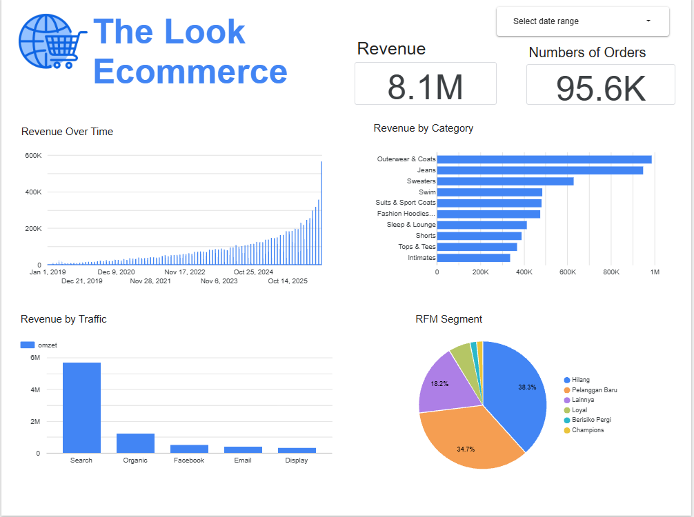

# E-commerce Analysis with BigQuery and Looker Studio

An end-to-end analytics project: SQL analysis in Google BigQuery on the public `thelook_ecommerce` dataset, with an interactive dashboard built in Looker Studio.

## Business Questions

1. How does revenue trend from month to month?
2. Which product categories are the most profitable?
3. Which traffic sources generate the most revenue?
4. Which customers are the most valuable, and which are at risk of leaving?

## Tools

- Google BigQuery (sandbox) and SQL
- Looker Studio
- GitHub

## Dataset

Source: `bigquery-public-data.thelook_ecommerce`, a public synthetic e-commerce dataset provided by Google.

The analysis uses three tables: `order_items`, `products`, and `users`. The tables were copied into my own BigQuery dataset (`thelook_analysis`) before analysis.

## Method

1. Copied the source tables into a personal BigQuery dataset in the same location (US) as the public data.
2. Built one SQL view per business question, so the dashboard reads clean, analysis-ready data.
3. Connected the views to Looker Studio as data sources and built the dashboard.
4. Queried the views again to extract the key figures reported below.

| View | Answers | What it contains |
|---|---|---|
| `monthly_revenue` | Question 1 | Orders and revenue per month |
| `category_profit` | Question 2 | Units, revenue, and profit per category per day |
| `traffic_source_revenue` | Question 3 | Revenue per traffic source per day |
| `rfm_segmen` | Question 4 | RFM score and segment for every customer |

## Analytical Decisions

- **Cancelled and Returned orders are excluded** from all revenue and profit figures, so the numbers reflect completed sales.
- **Frequency in the RFM model is capped at 5 instead of being split with `NTILE`.** Most customers have placed only one order, so splitting frequency into quintiles would be unfair.
- **Date columns were added to `category_profit` and `traffic_source_revenue`** so the date range control in Looker Studio can filter those charts.
- **The RFM chart is intentionally not filtered by date**, because segments are calculated from each customer's full purchase history.

### RFM segment definitions

| Segment | Rule |
|---|---|
| Champions | Recency score ≥ 4 and frequency score ≥ 4 |
| Loyal | Recency score ≥ 3 and frequency score ≥ 3 |
| New Customers (Pelanggan Baru) | Recency score ≥ 4 and frequency score ≤ 2 |
| At Risk (Berisiko Pergi) | Recency score ≤ 2 and frequency score ≥ 3 |
| Lost (Hilang) | Recency score ≤ 2 and frequency score ≤ 2 |
| Other (Lainnya) | Everything else |

Rules are applied top to bottom; the first matching rule decides the segment.

## Key Findings

1. **Revenue trend:** The highest monthly revenue was recorded in October, at 564,483.48.
2. **Product categories:** Outerwear & Coats is the most profitable category, with a profit of 548,811.32.
3. **Traffic sources:** Search generates the most revenue, about 5.68 million, which is 70.2% of total revenue.
4. **Customer segments:** Lost (38.3%) and New Customers (34.7%) dominate the customer base, together making up 73.0% of all customers. Both segments have low purchase frequency (at most 2 orders).

## Business Recommendations

- **Reduce dependence on a single channel.** Search accounts for 70.2% of revenue, so a small change in this channel has a large impact. Protect Search performance while testing other channels.
- **Prioritize Outerwear & Coats.** As the most profitable category, it deserves priority in stock planning and promotions.
- **Run a win-back campaign for the Lost segment (38.3% of customers)**, for example an email with a special offer for customers who have not purchased for a long time.
- **Encourage a second purchase from New Customers (34.7%)**, for example a voucher for their next order, to help them move into the Loyal segment.

## Dashboard



[View the live dashboard](https://datastudio.google.com/reporting/69676926-33d0-426f-8ec2-c8585f0eeed7) -->

> Note: BigQuery sandbox tables and views expire after 60 days. If the live dashboard stops loading, re-run the SQL script to rebuild them. The screenshot above shows the dashboard as built.

## Skills Demonstrated

**BigQuery (SQL)**
- Aggregations and multi-table joins (`order_items`, `products`, `users`)
- CTEs and window functions (`NTILE`) for RFM customer segmentation
- Date functions (`DATE_TRUNC`, `DATE_DIFF`) for trend and recency analysis
- `CREATE TABLE AS` and `CREATE VIEW` to build a data layer for dashboards
- Dataset location handling so public and personal data can be queried together

**Looker Studio**
- Connecting BigQuery views as data sources, with several data sources in one report
- Scorecards, time series, and categorical charts
- Date range control and per-chart date range dimensions
- Sharing the dashboard through a public link

## Repository Structure

```
bigquery-ecommerce-analysis/
├── README.md
├── sql/
│   └── bigquery_ecommerce_queries.sql
└── images/
    └── dashboard.png
```

## Reproducing This Project

1. Create a Google Cloud project and open BigQuery (the free sandbox is enough to start).
2. Create a dataset named `thelook_analysis` in the **US** location.
3. Run the sections of `sql/bigquery_ecommerce_queries.sql` in order. Replace the project ID `portfolio-bigquery-512504` with your own.
4. Connect the resulting views to Looker Studio and build the charts.
